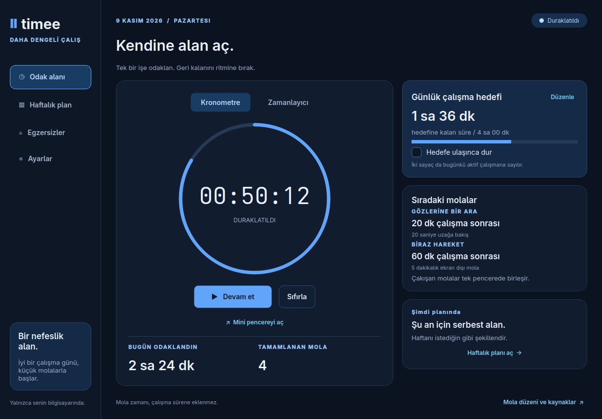

# Timee

Timee is a local-first desktop timer for people who spend long periods working at a desk. It combines a stopwatch, a countdown timer, evidence-informed break reminders, guided eye-rest and movement activities, a weekly hourly planner, and a daily work target in one focused Linux application.

The interface is currently in Turkish. This README is written in English for users, contributors, and reviewers.



## Why Timee?

A timer can measure a session, but it does not usually help with the surrounding workday. Timee treats focused work, short recovery breaks, movement, and planning as parts of the same flow:

- it counts only active work time;
- it pauses the active counter when a break reminder opens;
- it resumes only when the counter had been running before the break;
- it combines reminders that would otherwise appear close together;
- it keeps daily goals and a recurring weekly plan in the same application;
- it stores everything locally, without an account or cloud service.

## Features

### Stopwatch and countdown timer

- Use either the stopwatch or the configurable countdown timer.
- Start, pause, resume, and reset from the main window.
- Switching modes pauses the current session; only one mode runs at a time.
- A completed countdown remains paused and can be started again as a new session.
- System suspend and long event-loop interruptions are not credited as work time. On Linux, Timee uses `CLOCK_BOOTTIME` when available so a suspend gap can be detected.

### Resizable mini timer

- Open a compact floating view for either timer mode.
- Drag the frameless surface to reposition it.
- Resize it from the lower-right corner between `220 × 120` and `640 × 360` pixels; its last size is restored the next time it opens.
- Start or pause the shared session directly from the mini window.
- Close only the mini window while leaving the timer and main application running.
- No operating-system title bar, minimize button, or window close button is shown; the mini view uses its own compact controls.
- On KDE Plasma, an exact-title KWin rule for `Timee · Mini sayaç` keeps only the Timee mini timer in the overlay layer, including above full-screen applications, and remembers its position.

The main window and the mini window are two views of the same session. Opening or closing the mini view never creates a second timer.

### Eye-rest reminders

The default is a 20-second eye-rest reminder after every 20 minutes of active work. The primary guidance is to stop looking at the display and look at a real object approximately 6 metres (20 feet) away. The animation explains the activity; users are not asked to track an on-screen object during the rest itself.

The interval can be enabled, disabled, or changed in Settings.

### Movement reminders

The default movement reminder appears after 60 minutes of active work and provides a five-minute screen-away break. Available guided activities include:

- a short walk or posture change;
- controlled sit-to-stand repetitions;
- supported heel raises;
- a gentle seated chest stretch;
- shoulder rolls;
- opening and closing the hands.

Movement guidance includes an instruction to stay within a comfortable range and stop if pain occurs. Short guided movements are options within the five-minute screen-away break, not a claim that a few seconds of animation replaces the full break.

### Calm reminder scheduling

- Reminder cadence advances only while a counter is actively running.
- Paused time, exercise time, and system suspend time do not advance the next reminder.
- Eye and movement reminders that fall within three minutes of each other are combined into one break flow.
- Timer or daily-goal completion takes priority over a reminder.
- Completing a break increments the completed-break count.
- Skipping or closing a break resets that reminder's cadence and resumes a previously running timer, but does not record a completed break.
- Starting an exercise manually from the library pauses the active timer; if the timer was already idle or paused, it stays that way afterward.

### Guided activity library

Timee contains animated, source-linked guidance for eye rest and gentle desk-friendly movement. Each card shows the activity, suggested repetitions or duration, where it can be performed, and the institution used as its source.

Animations can be reduced in Settings. Sound is disabled by default and can be enabled for the end of a guided activity.

### Daily work target

- Set a daily target shared by the stopwatch and countdown timer.
- All active work contributes to today's total, even when “stop at target” is disabled.
- When “stop at target” is enabled, the active timer pauses exactly at the target boundary.
- Breaks and manually paused time never count toward the target.
- Today's work and completed-break count reset on the next local calendar day; lifetime work remains available internally.

### Recurring weekly planner

- Create tasks for Monday through Sunday.
- Choose start and end times to the minute.
- Edit or delete tasks by opening their cards.
- The current task is highlighted and shown on the focus dashboard.
- Tasks recur every week.
- Time blocks may touch but cannot overlap on the same day.
- A block cannot cross midnight; split overnight work into two entries.
- Invalid saved entries are ignored so one damaged planner record cannot prevent the application from opening.

### Local and resilient persistence

Timee does not require an account, server, or internet connection for normal use. It saves preferences, planner entries, timer state, work totals, and reminder cadence in a local JSON file.

Writes use a temporary file followed by an atomic replacement. If the original JSON is damaged or unreadable, Timee preserves it and writes new data to a recovery file rather than overwriting the damaged evidence. A lock file prevents two Timee processes from writing to the same data directory concurrently.

Restored sessions never start unattended: a running or break state is restored as paused, and time spent while the application was closed is not counted.

## Health guidance and evidence boundaries

Timee is a break reminder and activity guide. It is not medical advice, a vision treatment, a diagnostic tool, or a personalised exercise programme.

The default eye-rest guidance is based on the American Optometric Association's practical 20-20-20 recommendation and the American Academy of Ophthalmology's guidance to blink and periodically look away from a screen. The default movement interval is a product choice based on the UK Health and Safety Executive's example of a 5–10 minute screen break after 50–60 minutes of continuous display work. The movement instructions are mapped to NHS and Newcastle Hospitals NHS guidance.

These sources support practical break and movement guidance; they do not prove that every activity works for every person or that the exact 20-20-20 numbers are optimal. Timee makes no claim to correct myopia, strengthen eye muscles, or improve vision through on-screen tracking.

See [the source and evidence notes](docs/health-sources.md) for the complete mapping, limitations, and links.

## Requirements

- Linux desktop environment
- Python 3.10 or newer
- PySide6 6.8 or newer, below PySide6 7

Timee is developed and verified primarily on Fedora with KDE Plasma and Wayland. Its native Qt interface can also run on other Linux desktop environments and X11. Always-on-top behavior outside KDE depends on the target compositor or window manager honoring Qt's standard window hint.

For KDE Plasma integration, the optional installer expects:

- `kwriteconfig6`
- `kreadconfig6`
- `qdbus-qt6` for immediate KWin reconfiguration when available

## Quick start

Clone the repository and enter the project directory:

```bash
git clone https://github.com/emirkaganyigit/timee.git
cd timee
```

The repository is private. The clone command therefore requires a GitHub account with access and may prompt for authentication.

If the system Python already provides PySide6:

```bash
./run.sh
```

Otherwise, create an isolated virtual environment:

```bash
python3 -m venv .venv
.venv/bin/python -m pip install --upgrade pip
.venv/bin/python -m pip install -r requirements.txt
./run.sh
```

The launcher prefers a system `python3` that can import PySide6, then falls back to `.venv/bin/python`. Set `TIMEE_PYTHON` to select a specific interpreter:

```bash
TIMEE_PYTHON=.venv/bin/python ./run.sh
```

For compatibility with older Mola installations, `MOLA_PYTHON` is still accepted when `TIMEE_PYTHON` is not set.

The project can also be installed as a Python package:

```bash
.venv/bin/python -m pip install .
timee
```

Do not use `sudo pip` to install Timee into Fedora's system Python.

## Add Timee to the application menu

After confirming that `./run.sh` works, run:

```bash
./scripts/install-desktop.sh
```

The installer works at user scope and does not require administrator privileges. It installs:

```text
${XDG_DATA_HOME:-$HOME/.local/share}/applications/io.github.emirkaganyigit.timee.desktop
${XDG_DATA_HOME:-$HOME/.local/share}/icons/hicolor/scalable/apps/io.github.emirkaganyigit.timee.svg
```

The application ID is `io.github.emirkaganyigit.timee`. On KDE Plasma, the installer also installs the narrowly scoped KWin rule described below. The desktop entry points to this checkout's `run.sh`; run the installer again if the repository is moved.

## KDE Plasma and Wayland overlay rule

Wayland compositors decide whether to honor a client's always-on-top request. Timee uses Qt's `WindowStaysOnTopHint` on every desktop, and the desktop installer adds a stronger KDE-specific rule for predictable Plasma behavior.

The rule:

- matches the exact title `Timee · Mini sayaç`;
- does not apply to the main window, exercise dialogs, or other applications;
- forces `keepAbove=true`;
- places the mini timer in KWin's overlay layer;
- remembers the window position;
- keeps the mini timer out of the taskbar, pager, and application switcher.

The screen lock and other secure desktop surfaces remain under the compositor's control.

To reinstall or refresh only this rule:

```bash
./scripts/install-kwin-rule.sh
```

To remove it safely, open **System Settings → Window Management → Window Rules**, locate the Timee mini-timer rule whose title match is `Timee · Mini sayaç`, and remove that rule. Then ask KWin to reload its configuration, if necessary:

```bash
qdbus-qt6 org.kde.KWin /KWin org.kde.KWin.reconfigure
```

## Remove the application-menu entry

Removing the launcher does not remove Timee's local planner or timer data.

```bash
rm -f "${XDG_DATA_HOME:-$HOME/.local/share}/applications/io.github.emirkaganyigit.timee.desktop"
rm -f "${XDG_DATA_HOME:-$HOME/.local/share}/icons/hicolor/scalable/apps/io.github.emirkaganyigit.timee.svg"
```

Also remove the KWin rule through KDE System Settings as described above. If Timee was installed as a Python package, remove that package with the same interpreter that installed it:

```bash
.venv/bin/python -m pip uninstall timee-desktop
```

Deleting the launcher, Python package, or project checkout does not delete saved Timee data. Back up the data directory before removing it separately.

## Data location and privacy

By default, Timee stores its state at:

```text
$XDG_DATA_HOME/timee/state.json
```

When `XDG_DATA_HOME` is not defined, the path is:

```text
~/.local/share/timee/state.json
```

Use a separate data directory for testing or multiple independent profiles:

```bash
TIMEE_DATA_DIR=/tmp/timee-demo ./run.sh
./run.sh --data-dir /tmp/timee-demo
```

The command-line option takes precedence over the environment variable.

The complete data-directory precedence is:

1. `--data-dir PATH`
2. `TIMEE_DATA_DIR`
3. `MOLA_DATA_DIR`, retained as a compatibility fallback
4. `$XDG_DATA_HOME/timee`, or `~/.local/share/timee` when `XDG_DATA_HOME` is unset

### Migration from Mola

Timee's internal Python module remains named `mola`, but its public command, application name, desktop identity, and default data directory use the Timee name.

On the first default-path launch, if Timee has no `state.json` and a valid legacy file exists at `$XDG_DATA_HOME/mola/state.json` (normally `~/.local/share/mola/state.json`), Timee copies that state into the new `timee` directory. The original Mola file remains untouched as a backup. An existing Timee state always wins, and an invalid legacy file is ignored. Automatic migration is intentionally skipped when `--data-dir`, `TIMEE_DATA_DIR`, or `MOLA_DATA_DIR` selects an explicit directory.

Timee has no account system, analytics, telemetry, advertising, or background network service. Opening a health-source link launches the default browser and visits the linked institution's website; that browser request is the only network-related action initiated from within the interface.

## Development

Create a development environment:

```bash
python3 -m venv .venv
.venv/bin/python -m pip install -r requirements.txt
```

Run directly from the source tree:

```bash
TIMEE_DATA_DIR=/tmp/timee-development .venv/bin/python -m mola.app
```

The internal Python package is currently named `mola`; this does not affect the Timee application name or desktop identity. Use a temporary data directory during development to avoid changing personal planner or timer data.

### Project structure

```text
.
├── assets/
│   ├── io.github.emirkaganyigit.timee.desktop  # desktop-entry template
│   └── timee.svg                  # application icon
├── docs/
│   ├── health-sources.md          # source mapping and evidence limits
│   └── screenshots-timee/         # current blue-theme screenshots
├── mola/
│   ├── animation.py               # vector timer and exercise rendering
│   ├── app.py                     # main, mini, settings, and dialog windows
│   ├── content.py                 # activities and source metadata
│   ├── engine.py                  # clock-independent session state machine
│   ├── planner.py                 # recurring weekly planner and validation
│   ├── storage.py                 # atomic local persistence
│   ├── theme.py                   # dark blue palette and shared widgets
│   └── wellness.py                # exercise library and break flows
├── scripts/
│   ├── install-desktop.sh         # user-level desktop integration
│   └── install-kwin-rule.sh       # KDE mini-overlay integration
├── tests/
│   ├── test_engine.py
│   ├── test_integration.py
│   ├── test_planner.py
│   └── test_storage.py
├── pyproject.toml
├── requirements.txt
└── run.sh
```

The `Engine` class accepts injected clock and date functions, allowing timer, suspend, daily-rollover, reminder-coalescing, and completion behavior to be tested without waiting in real time.

## Testing

Run the complete suite without opening desktop windows:

```bash
QT_QPA_PLATFORM=offscreen python3 -m unittest discover -s tests -v
```

With a virtual environment:

```bash
QT_QPA_PLATFORM=offscreen .venv/bin/python -m unittest discover -s tests -v
```

The tests cover:

- stopwatch and countdown boundaries;
- work-only accounting and daily targets;
- simultaneous and near-simultaneous reminders;
- completed, skipped, closed, and manually opened break flows;
- system-suspend gaps and day rollover;
- save and restore behavior;
- legacy Mola-to-Timee state migration;
- mini-window controls sharing the main session;
- planner validation and overlap rules;
- Unicode persistence, damaged files, and failed atomic replacement.

Offscreen Qt tests cannot prove real compositor stacking behavior. On KDE Plasma, also verify the mini timer with a normal window and a full-screen window after installing the KWin rule.

## Accessibility and comfort

- Controls expose accessible names where their visual label is insufficient.
- Focus states use a high-contrast blue outline.
- The dark blue palette maintains clear text and control contrast.
- Important instructions use text as well as animation.
- Reduced-motion mode stops nonessential exercise animation.
- Completion sound is optional and disabled by default.
- Exercise instructions are available without relying on color alone.
- The mini window retains explicit start/pause and close controls at compact sizes.

Timee has not yet undergone a formal WCAG or assistive-technology conformance audit. Accessibility feedback and platform-specific testing are welcome once a contribution policy and license are established.

## Troubleshooting

### `PySide6` cannot be imported

Create the virtual environment and install `requirements.txt`, then run Timee again:

```bash
python3 -m venv .venv
.venv/bin/python -m pip install -r requirements.txt
TIMEE_PYTHON=.venv/bin/python ./run.sh
```

### Timee says another instance is open

Only one process may use a data directory at a time. Bring the existing window forward or close it normally. A stale lock is handled by Qt; do not delete state files while Timee is running.

### The mini timer is not above other windows on KDE

1. Close and reopen the mini timer after installing a rule.
2. Run `./scripts/install-kwin-rule.sh`.
3. Confirm that the rule matching `Timee · Mini sayaç` is enabled in KDE's Window Rules settings.
4. Run `qdbus-qt6 org.kde.KWin /KWin org.kde.KWin.reconfigure`.

On other compositors, use the window manager's application or title rule if its standard always-on-top handling is insufficient.

### Timee was moved to another directory

The application-menu entry contains an absolute path to `run.sh`. Run `./scripts/install-desktop.sh` again from the new checkout.

### The saved state is damaged

Timee preserves an unreadable `state.json` and switches to `state-recovered.json`. Inspect or back up both files before replacing them. A visible banner reports the recovery condition.

### A task cannot be added to the planner

Check that the title is nonempty, the end is later than the start, and the interval does not overlap another task on the same day. Split a task that crosses midnight into two entries.

## Current limitations

- The application interface is currently Turkish-only.
- Weekly planner entries recur every week; exceptions, one-off dates, notifications for task boundaries, and calendar sync are not implemented.
- There is no cloud sync, mobile companion, system-tray mode, or multi-device account.
- The KDE overlay rule is compositor-specific. Other desktop environments may handle always-on-top hints differently.
- The mini timer's remembered position is managed by KWin on KDE; behavior on multi-monitor changes depends on the compositor.
- Health guidance is general and does not replace advice from a qualified clinician.

## Sources

The full annotated source list is maintained in [docs/health-sources.md](docs/health-sources.md). Primary institutional sources include:

- [American Optometric Association — Computer vision syndrome and the 20-20-20 rule](https://www.aoa.org/healthy-eyes/eye-and-vision-conditions/computer-vision-syndrome/20-20-20-rule?sso=y)
- [American Academy of Ophthalmology — Computers, digital devices, and eye strain](https://www.aao.org/eye-health/diseases/computer-usage)
- [UK Health and Safety Executive — Work routine and breaks](https://www.hse.gov.uk/msd/dse/work-routine.htm)
- [NHS — Strength exercises](https://www.nhs.uk/live-well/exercise/strength-exercises/)
- [NHS — Sitting exercises](https://www.nhs.uk/live-well/exercise/sitting-exercises/)
- [Newcastle Hospitals NHS — One-minute body check](https://www.newcastle-hospitals.nhs.uk/services/newcastle-occupational-health-service/information-for-staff/physiotherapy/self-help-leaflets/1-minute-body-check/)

## Licensing and contributions

No `LICENSE` file is included at this time, and contribution terms have not yet been defined. The private repository's issue tracker can be used by collaborators with access for reproducible bug reports, expected behavior, Fedora/KDE version details, and accessibility feedback.
